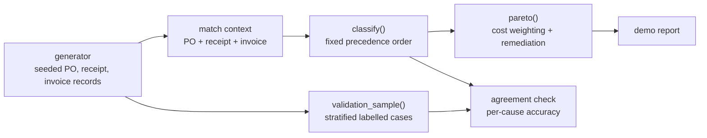

# p2pexceptions

Invoice exception analysis that assigns every failed three-way match exactly one cause, validates the assignment against labelled cases, and ranks causes by cost.

[](https://github.com/SlateGitOrg/p2pexceptions/actions/workflows/ci.yml)

## Why

Around 18% of supplier invoices fail three-way match (purchase order, goods receipt, invoice) and are cleared by hand. It is usually written off as a supplier data problem, but the categories in the typical analysis overlap: an invoice that is both short-delivered and mispriced lands in two buckets, the percentages add up to more than 100, and no single fix owns a bar on the chart. This project uses a mutually exclusive, exhaustive cause taxonomy and weights it by cost, so each bar maps to one costed remediation.

## Features

- Three-way match reconstruction with tolerances held as named constants.
- A classifier that assigns exactly one cause per exception using a fixed, documented precedence order.
- An `unclassified` bucket that is always reported and tested to stay below 3%.
- Cost weighting per exception: handling minutes plus late-payment risk.
- A cost-weighted Pareto with a named remediation per cause, and a side-by-side ranking by count versus by cost.
- A seeded synthetic procure-to-pay generator and a stratified labelled validation sample.

## Architecture



The generator plants each cause at a known rate and records the intended cause as the label. `classify()` evaluates a match context against the rules in precedence order and returns one cause. `pareto()` counts exceptions per cause, applies cost weights and attaches a remediation. More detail in [docs/ARCHITECTURE.md](docs/ARCHITECTURE.md).

## Quick start

Requires Python 3.11+. There are no third-party dependencies.

```bash
git clone https://github.com/SlateGitOrg/p2pexceptions.git
cd p2pexceptions
python -m unittest discover -s tests -v   # run the test suite
python -m src.demo                        # generate data and print the report
```

## Usage

`python -m src.demo` generates 400,000 invoice lines (fixed seed), classifies the exceptions and prints the report. Trimmed output:

```text
  400,000 invoice lines, 72,739 failed three-way match (18.2%).

  Classifier agreement with a hand-labelled sample of 800: 99.6%
  Unclassified: 0.00% (reported, not folded into 'other')

  cause                        count  % count   annual cost  % cost    cum
  price_off_contract           8,516    11.7%     2,450,905   25.5%    26%
  quantity_short_delivery     11,765    16.2%     2,145,465   22.4%    48%
  goods_receipt_missing        4,797     6.6%     1,365,418   14.2%    62%
  quantity_over_delivery       7,017     9.6%     1,079,495   11.3%    73%
  po_line_rounding            28,697    39.5%       983,733   10.3%    84%
  ...
```

Costs are in GBP, annualised from a one-quarter log (x4). They come from the explicit assumptions in `src/classify.py`, not from real data.

## How it works

- **Precedence order.** Duplicate, no PO, missing receipt, short or over delivery, rounding, price off contract, tax code. The first rule that fires wins, which makes the taxonomy mutually exclusive; anything left is `unclassified`, which makes it exhaustive.
- **Rounding versus price.** A unit-price difference of at most 0.005 is what rounding a 4dp contract price to 2dp produces. It is checked before price and treated as a price-list configuration issue. Matching is done on line total (tolerance 0.50), so the same drift is invisible on a small line and fails the match on a large one.
- **Cost versus count.** `po_line_rounding` is the largest cause by count (39.5%) but only fifth by cost, while `price_off_contract` is third by count and first by cost. The report shows both rankings.
- **Validation.** Agreement is measured against the generator's intended cause on a stratified sample, overall and per cause. Because the data is synthetic, this shows the rules are internally consistent, not that they hold on real ledgers.

## Testing

```bash
python -m unittest discover -s tests -v
```

24 tests cover: exactly one cause per exception, unclassified below 3%, shares summing to one, at least 95% agreement with labels overall and for every cause, recovery of seeded rates, each precedence rule, the rounding versus price separation, and ordering of the Pareto by cost.

## Project layout

```text
src/
  classify.py    taxonomy, precedence rules, cost model, Pareto
  generator.py   synthetic records and labelled validation sample
  demo.py        report
tests/           unittest suite
docs/            architecture notes
```

## Limitations

- Data is synthetic; no ERP or database integration.
- Cost constants (handling minutes, late-payment risk, penalty) are assumptions to be replaced with measured values.
- An invoice with several problems is attributed only to the highest-precedence cause.
- Python only; there is no SQL or dbt layer.

## License

MIT — see [LICENSE](LICENSE).
