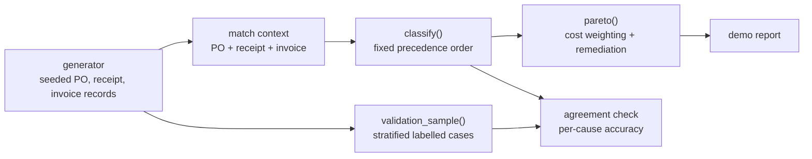

# Architecture

## Context

Supplier invoice lines that fail three-way match (purchase order, goods
receipt, invoice) land in an exception queue that is cleared by hand. A
typical analysis buckets those exceptions with overlapping categories, so the
percentages cannot be acted on. The demo data is synthetic, with seeded cause
rates that give roughly 18% failing lines. p2pexceptions assigns each
exception exactly one cause, validates that assignment against labelled
cases, and weights the result by cost.

## Container view

Everything is standard-library Python. The generator plants each cause at a
known rate, so both the classifier and the recovered rates can be scored.

## Key decisions

**Fixed precedence order (MECE by construction).** `classify()` returns one
cause per exception, checked in order: duplicate, no PO, missing receipt,
quantity (short, then over), rounding, price, tax code. The order is the
policy and determines every percentage. Anything unmatched falls into
`unclassified`, which is always reported. Trade-off: an invoice with two real
problems is attributed to the higher-precedence one, so the lower one is not
counted until the first is fixed.

**Rounding is checked before price.** A unit-price difference of at most
0.005 is what rounding a 4dp contract price to 2dp produces. It is a
price-list configuration issue, not a commercial dispute. The match is done
on line total (tolerance 0.50), so the same drift is invisible on a 3-unit
line and fails the match on a 300-unit line.

**Cost weighting instead of counting.** Cost per exception is handling
minutes times labour cost per minute, plus late-payment probability times
average penalty. The tables are explicit constants in `src/classify.py` so
they can be challenged. Ranking by cost and ranking by count differ, and the
report shows both.

**Validation against independent labels.** The generator records the cause it
intended for each case. A stratified sample (so rare causes are represented)
is scored against the classifier, overall and per cause.

## Failure modes

- A case that fits no rule lands in `unclassified`, which is reported and
  must stay below 3% (asserted in the tests).
- Cost constants are assumptions, not measurements. Changing them changes the
  ranking by cost but not the classification.
- Tolerances are module-level constants; a different tolerance policy gives
  different counts.

## Out of scope

- OCR or invoice capture: the input is structured records.
- A real ERP or database connection: data comes from the synthetic generator.
- SQL or dbt models: the implementation is Python only.
